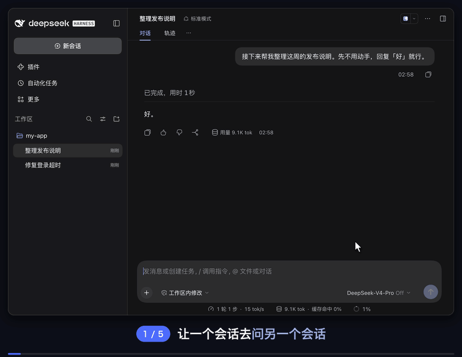
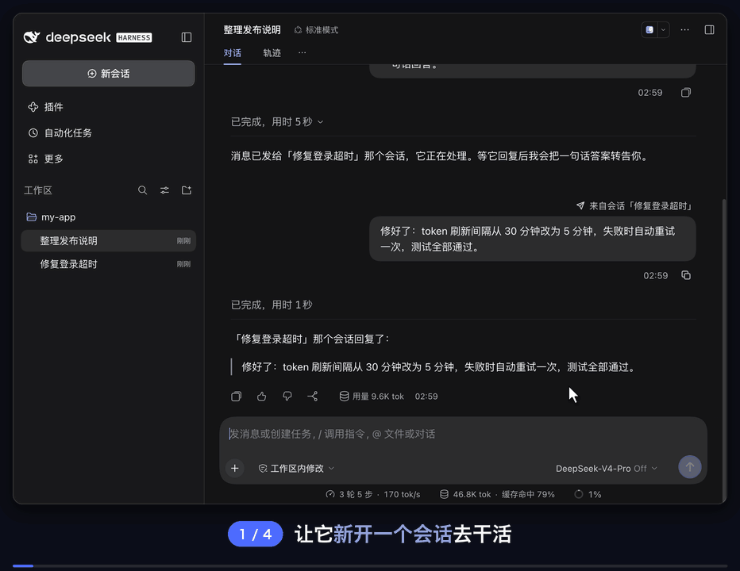
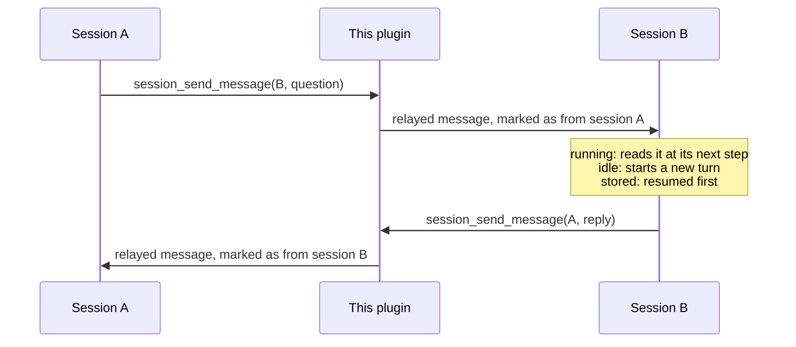

<div align="center">


# dsh-session-messaging

**Let sessions message each other** — one session can find another, send it a message, or open a new session with a task; the other side replies the same way.


[中文](README.md) · **English**

[Features](#features) · [Installation](#installation) · [Usage](#usage) · [Settings](#settings) · [How it works](#how-it-works) · [Known limitations](#known-limitations)

</div>

<br>

A community plugin for [DeepSeek Harness](https://github.com/deepseek-ai/deepseek-harness). Every built-in message channel in DSH needs a relationship between the two sides: `send_message` only reaches a direct parent or child agent, and Agent Teams only reaches members of the same Team, so two ordinary sessions in the sidebar have no way to talk. With this plugin, every top-level session gets three tools: find sessions, send a message, and open a new session. A received message says which session it came from, and the recipient can reply with the same tool.

<p align="center">
  
</p>

<p align="center"><sub>The agent in “整理发布说明” (prepare release notes) finds “修复登录超时” (fix login timeout) with <code>session_list</code> and sends its question with <code>session_send_message</code>. The other session wakes up and replies, and the reply wakes the first session again. The demo was recorded with the Chinese interface, so captions and labels appear in Chinese.</sub></p>

## Features

- 🔎 **Find sessions** — `session_list` lists the sessions you can message, most recently active first, with id, running / idle status and title. It covers the current workspace by default, and can list every workspace or search by title.
- ✉️ **Send messages** — `session_send_message` delivers a message to another session: a running session reads it at its next step, an idle session starts a new turn with it, and a stored (not loaded) session is resumed first.
- 🆕 **Open new sessions** — `session_create` opens a titled session in the sidebar and starts its first turn with your message. The new session works on its own and cannot see the creator's conversation; ask it to report back in the message and it will.
- 🏷️ **Shows the sender** — a received message appears as a user-style bubble marked “From session “title””. The model sees an attribution line: which session sent it, that the other session's agent wrote it rather than the user, and how to reply.
- 🔁 **No pleasantry loops** — the attribution line tells the recipient not to reply only to acknowledge, so two sessions don't trade “got it” and “thanks” forever.
- 🛡️ **Bounded** — it refuses to message itself, subagent sessions or archived sessions; one message is capped at 64 KB; each session can open at most 10 new sessions per run; subagents don't see the three tools.

## Installation

**Requirements:** DeepSeek Harness `0.2.0+` (tested with `0.2.1-rc.5` on macOS). The plugin itself calls no model, so it needs no extra API key.

### Option 1: Paste one sentence to DSH (self-install)

Paste this sentence into any DeepSeek Harness chat — the agent detects Desktop vs Web automatically, installs the plugin into your active profile, and mounts it live:

```text
Install the plugin https://github.com/tonyzdev/dsh-session-messaging into my current DSH profile: if `plugin_manager` is available, call `install_bundle` to install and enable it; otherwise read the active profile (`$DSH_PROFILE` in bash, `$env:DSH_PROFILE` in PowerShell), use Desktop's bundled CLI (`runtime/cli/bin/dsh` or `dsh.cmd` next to `app.asar`) when the profile is `desktop` or `dsh` on PATH otherwise (requesting sandbox approval if needed), and run `dsh plugin --profile <profile> add github:tonyzdev/dsh-session-messaging` — do not hand-edit profile files or restart the host.
```

### Option 2: Install in the GUI

Open **Plugins → Add plugin** in the Harness sidebar, enter the repository URL below, click **Install**, and click **Enable now** (refresh the page with `⌘R` / `Ctrl+R` if relayed message bubbles don't style immediately):

```text
https://github.com/tonyzdev/dsh-session-messaging
```

> [!IMPORTANT]
> Install using the full GitHub URL above — do **not** enter bare `dsh-session-messaging` (an unrelated package by another author holds that unscoped name on npm; this plugin's installed bundle name is `@tonyzdev/dsh-session-messaging`).

<details>
<summary><b>Command-line install, prebuilt tarball, or removal</b></summary>

<br>

**Web (`dsh web`):**

```sh
dsh plugin --profile web add github:tonyzdev/dsh-session-messaging
```

**Desktop (`DSH Desktop`, hot-loads fresh installs even while the app is open):**

macOS:

```sh
DSH="/Applications/DeepSeek Harness.app/Contents/Resources/runtime/cli/bin/dsh"
"$DSH" plugin --profile desktop add github:tonyzdev/dsh-session-messaging
```

Windows (PowerShell):

```powershell
& "$env:LOCALAPPDATA\Programs\DeepSeek Harness\resources\runtime\cli\bin\dsh.cmd" plugin --profile desktop add github:tonyzdev/dsh-session-messaging
```

> Note: On a machine with DSH Desktop, running `--profile web` installs into `profiles/web`, **not** the Desktop app. Use Desktop's bundled CLI with `--profile desktop` above, or **Plugins → Add plugin** inside the app.

**Prebuilt GitHub Release `.tgz` (no full git clone):**

```sh
dsh plugin --profile web add https://github.com/tonyzdev/dsh-session-messaging/releases/download/v0.3.2/tonyzdev-dsh-session-messaging-0.3.2.tgz
```

**Local development (install as a link so edits apply directly):**

```sh
git clone https://github.com/tonyzdev/dsh-session-messaging ~/.dsh/local-plugins/dsh-session-messaging
"$DSH" plugin --profile desktop add link:$HOME/.dsh/local-plugins/dsh-session-messaging
```

**Removing:** uninstall it on the Plugins page, or run:

```sh
"$DSH" plugin --profile desktop remove @tonyzdev/dsh-session-messaging
```

</details>

## Usage

You don't need the tool names; tell the agent what you want:

> Ask the “fix login timeout” session whether the bug is fixed and what changed.
>
> Tell the “frontend refactor” session that the API field `user_id` is now called `uid`.
>
> Open a new session to add this fix to CHANGELOG.md, and tell me when it's done.

<p align="center">
  
  <br>
  <sub>The new session appears in the sidebar and starts on its task; when it's done it reports back with <code>session_send_message</code>, and the first session receives the result.</sub>
</p>

| Tool | Parameters | What it does |
| --- | --- | --- |
| `session_list` | `query?` `all_workspaces?` `limit?` | Lists top-level sessions you can message, most recently active first |
| `session_send_message` | `session_id` `message` `delivery?` | Sends a message; `delivery: "queue"` waits until the recipient's current turn ends |
| `session_create` | `title` `message` `workspace?` | Opens a session and starts its first turn with the message; `workspace` takes an absolute path as `session_list` shows it |

The tools return a delivery confirmation, not the other session's answer; an answer arrives later as a new message in the sending session.

## Settings

| Field | Default | Description |
| --- | :---: | --- |
| `crossWorkspace` | `true` | Whether sessions in other workspaces can be listed, messaged, or opened; `false` keeps everything in the current workspace |
| `maxMessageBytes` | `65536` | Size limit of one message, including the attribution line |
| `listLimit` | `20` | Default number of rows `session_list` returns, at most 100 |
| `createLimit` | `10` | New sessions one session may open in one run |

> [!TIP]
> To change them, add a row to your profile's patch file (for the desktop app, `~/.dsh/profiles/desktop/cordis.patch.yml`). Write only the fields you want to change; the rest keep their defaults:
>
> ```yaml
> - id: session-messaging
>   config:
>     crossWorkspace: false
> ```
>
> It applies once saved; if it doesn't, restart DeepSeek Harness.

## How it works



<p align="center"><sub>Relayed messages are written to the recipient's session log; the model sees the attribution line, and the interface shows a bubble marked with the sender.</sub></p>

| File | Where | Role |
| --- | :---: | --- |
| `lib/index.js` | Host | The three tools, message relay, hiding the tools from subagents |
| `lib/client.js` | Browser | Draws relayed messages as user-style bubbles marked with the sending session |
| `cordis.patch.yml` | Patch | The plugin row and its default config |
| `locale/*.json`, `icon.svg` | Metadata | Name, description and icon on the Plugins page |

<details>
<summary><b>Implementation details</b></summary>

<br>

- Sending goes through `sessionController.resolveAgent`, the same path as a prompt from the web interface, which resumes a stored session when needed. The message carries DSH's built-in relay source `{ kind: 'agent-message', form: 'relay', senderSessionId }` and is written to the recipient's session log.
- Opening a session goes through `sessionController.create({ workspaceId })`, the web interface's new-chat path. The title is set before the first turn starts, because relayed messages never trigger DSH's automatic titling.
- Both run inside `withoutInitiator`: the other side is an independent top-level session, not work started by the sender's turn.
- The attribution line ends with a blank line, because adjacent text blocks reach the model joined together.
- Subagents get the three tools hidden with `agent.ctx.tools.restrict({ deny })` in `agent/created`, since they cannot receive replies through this channel.
- The browser half overrides the Chat `turn-trigger` renderer for this plugin's relayed messages only and reuses DSH's own `conversation.chat.user.content` bubble; goals, schedules, subagent results and other triggers keep the built-in card. Only the display changes; what the model receives stays the same.

</details>

## Known limitations

> [!CAUTION]
> **A session that is woken up or newly opened runs with its own settings.** New sessions use the default model and the default approval policy (`ask` in testing), not the creator's settings. If such a session needs an approval, the request waits in that session, where nobody may be watching.

- Only top-level sessions can talk this way; subagents and Team members still use DSH's built-in `send_message`.
- “Delivered” means the recipient's inbox accepted the message, not that it was processed; there are no retries, deduplication or read receipts.
- A message that arrives while the recipient is running joins its current turn: the model receives it, but it isn't shown as a bubble. Only messages that wake a session appear as bubbles.
- Bubbles don't render Markdown and don't collapse long messages.
- Sending has no rate limit; reply loops are discouraged only by the attribution line. `createLimit` lives in memory, resets when the plugin reloads or Harness restarts, and doesn't stop chains such as A opens B, then B opens C.
- A title set by `session_create` is fixed like a manual rename, so DSH won't retitle the session later.

## Development

```sh
node --test test/*.test.js
```

The tests drive a mocked Harness context through delivery, opening sessions, every refusal path, list filtering and hiding the tools from subagents, and check that the browser half can parse the attribution the Host writes (they fail if the two drift apart).

> [!NOTE]
> After changing `lib/index.js`, turn the plugin off and on again on the Plugins page to load the new code, without a restart; after changing `lib/client.js`, reinstall and refresh the page.
