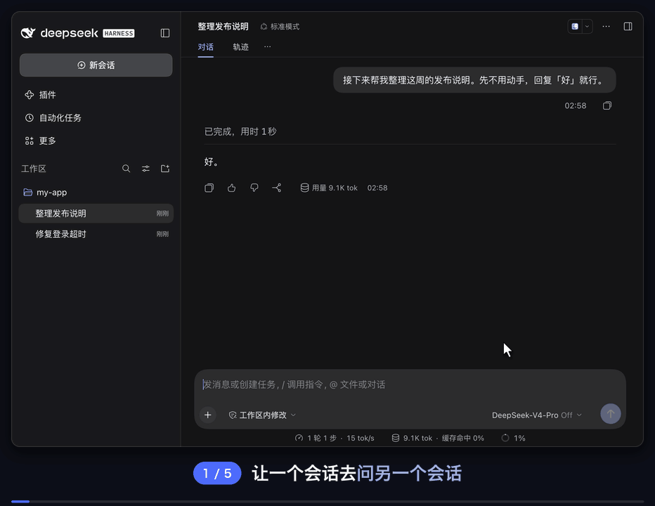
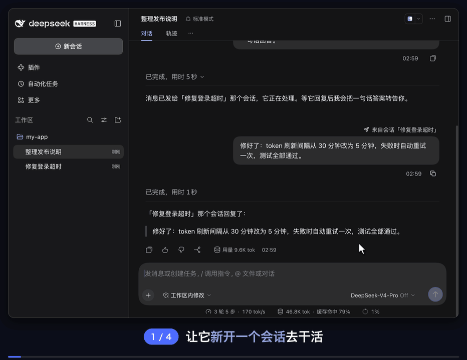
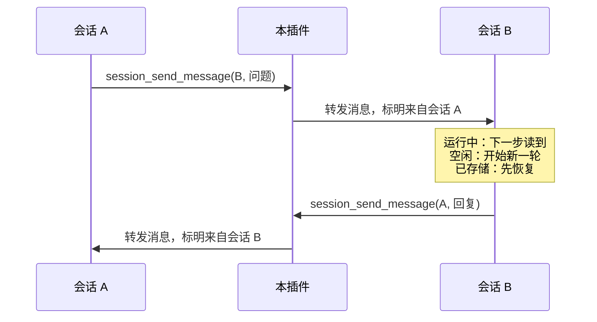

> **本包是自维护发布分支**：基于 [tonyzdev/dsh-session-messaging](https://github.com/tonyzdev/dsh-session-messaging)
> **v0.3.2（MIT，作者 tonyzdev）**，代码作为起点；版本号自成一条线（`0.1.0` 起），不延续上游编号。
>
> - 包名 `@zlzlk/dsh-session-messaging`，可在插件页填包名直接安装；
> - 与上游 v0.3.2 的差异见 [COMPATIBILITY.md](./COMPATIBILITY.md) 与 CHANGELOG；
> - Based on tonyzdev/dsh-session-messaging v0.3.2 (MIT, by tonyzdev). Independent version line from 0.1.0.

---

## 本 fork 的功能改进

### 1. `session_send_message` 支持子代理（`agent_id`）

- 原来只能给**顶层会话**发消息；现在还可以传 `agent_id`，把消息投递给**子代理**——你启动的子级，或你作为可继续子级时的直接父级。
- 走宿主 `ctx.subagents.sendMessage()`（与内置 `send_message` 同一个 seam），投递语义一致：工作中的目标在最近步骤边界收到，空闲目标被唤醒并开始一轮。
- **Team 成员仍请用内置 `send_message`**：团队成员不是子代理子级，这条通路不覆盖它们，这是宿主的结构限制，不是缺省。
- 宿主没有挂载 subagent 服务时会**明确报错**，不会静默丢消息。

### 2. 测试

`npm test`（`node --test test/*.test.js`）共 **24 项**：会话投递、开新会话、拒绝路径、列表过滤、对子代理隐藏工具、来源说明解析，以及新增的两条 `agent_id` 用例。

<div align="center">


# dsh-session-messaging

**让会话之间互相发消息** —— 一个会话可以找到另一个会话、给它发消息，或者新开一个会话交代任务；对方用同样的方式回复。


**中文** · [English](README.en.md)

[功能](#功能) · [安装](#安装) · [用法](#用法) · [设置](#设置) · [工作原理](#工作原理) · [已知限制](#已知限制)

</div>

<br>

[DeepSeek Harness](https://github.com/deepseek-ai/deepseek-harness) 社区插件。DSH 自带的消息通道都要求双方有关系：`send_message` 只在直接父子 agent 之间传递，Agent Teams 只在同一个 Team 的成员之间传递，侧栏里两个普通会话之间没有路。装上本插件后，每个顶层会话多了三个工具：找会话、发消息、开新会话。收到的消息会标明来自哪个会话，对方可以用同一个工具回复。

<p align="center">
  
</p>

<p align="center"><sub>「整理发布说明」里的 agent 用 <code>session_list</code> 找到「修复登录超时」，用 <code>session_send_message</code> 发出问题。对方被唤醒并回复，回复又唤醒了原会话。</sub></p>

## 功能

- 🔎 **找会话** — `session_list` 按最近活跃列出可以发消息的会话：id、运行中 / 空闲、标题。默认只看当前工作区，也可以列出全部工作区或按标题搜索。
- ✉️ **发消息** — `session_send_message` 把消息送到另一个会话：正在运行的会话在下一步读到，空闲的会话立即开始新一轮，已存储（未加载）的会话先恢复再处理。
- 🆕 **开新会话** — `session_create` 在侧栏新开一个带标题的会话，用你的消息开始第一轮。新会话独立干活，看不到发起方的对话；消息里让它回报，它就会回报。
- 🏷️ **标明来源** — 收到的消息显示为用户侧气泡，上方写着「来自会话「标题」」。模型看到的是一行来源说明：哪个会话、由对方的 agent 而不是用户撰写、怎么回复。
- 🔁 **不会互相客套** — 来源说明提醒对方不要只为确认收到而回复，两个会话不会来回说「收到」「好的」停不下来。
- 🛡️ **有边界** — 不能发给自己、子 agent 会话或已归档的会话；单条消息上限 64 KB；每个会话每次运行最多开 10 个新会话；子 agent 看不到这三个工具。

## 安装

**需要**：DeepSeek Harness `0.2.0+`（已在 macOS 版 `0.2.1-rc.5` 上实测）。插件本身不调用模型，不需要额外的 API key。

### 方式一：发一句话让 DSH 自己安装（推荐）

把下面这句话直接复制发给任意 DSH 会话，agent 会自动识别桌面端或网页端完成安装并热加载：

```text
请帮我在当前 DSH profile 安装插件 https://github.com/tonyzdev/dsh-session-messaging：若有 plugin_manager 工具请直接调用 install_bundle 安装并启用；否则读取当前 profile 名（bash 为 $DSH_PROFILE，PowerShell 为 $env:DSH_PROFILE；为 desktop 时调用 app.asar 同级 runtime/cli/bin 下的 dsh 或 dsh.cmd，其他情况用 PATH 中的 dsh，受沙箱限制时申请全盘权限审批）执行 dsh plugin --profile <profile> add github:tonyzdev/dsh-session-messaging，不要手改配置文件或重启宿主。
```

### 方式二：在「插件」页手动安装

在 Harness 侧栏打开 **插件 → 添加插件**，填入下面的仓库地址，点击 **安装** 后再点 **立即启用** 即可使用（若聊天里的转发气泡样式尚未出现，按 `⌘R` / `Ctrl+R` 刷新页面）：

```text
https://github.com/tonyzdev/dsh-session-messaging
```

> [!IMPORTANT]
> 安装时请填入上面的完整 GitHub 仓库地址，**不要**输入不带前缀的 `dsh-session-messaging`（npm 上同名无前缀包由其他作者维护；本插件安装后的包名为 `@tonyzdev/dsh-session-messaging`）。

<details>
<summary><b>用命令行安装、离线包安装或移除</b></summary>

<br>

**网页端（`dsh web`）**：

```sh
dsh plugin --profile web add github:tonyzdev/dsh-session-messaging
```

**桌面端（DSH Desktop，支持在应用运行时首次热装）**：

macOS：

```sh
DSH="/Applications/DeepSeek Harness.app/Contents/Resources/runtime/cli/bin/dsh"
"$DSH" plugin --profile desktop add github:tonyzdev/dsh-session-messaging
```

Windows（PowerShell）：

```powershell
& "$env:LOCALAPPDATA\Programs\DeepSeek Harness\resources\runtime\cli\bin\dsh.cmd" plugin --profile desktop add github:tonyzdev/dsh-session-messaging
```

> 注意：在装有 DSH Desktop 的电脑上如果运行 `--profile web`，插件只会装进 `profiles/web`，不会出现在桌面端界面里；桌面端请使用上面的内置 CLI 指向 `--profile desktop`，或直接在界面「插件 → 添加插件」中安装。

**预打包 Release `.tgz` 直装（无需拉取完整 Git 仓库）**：

```sh
dsh plugin --profile web add https://github.com/tonyzdev/dsh-session-messaging/releases/download/v0.3.2/tonyzdev-dsh-session-messaging-0.3.2.tgz
```

**本地开发（以链接方式安装，改代码直接作用于该副本）**：

```sh
git clone https://github.com/tonyzdev/dsh-session-messaging ~/.dsh/local-plugins/dsh-session-messaging
"$DSH" plugin --profile desktop add link:$HOME/.dsh/local-plugins/dsh-session-messaging
```

**移除**：在「插件」页卸载，或运行：

```sh
"$DSH" plugin --profile desktop remove @tonyzdev/dsh-session-messaging
```

</details>

## 用法

不用记工具名，直接告诉 agent 要做什么：

> 问问「修复登录超时」那个会话：bug 修好了吗？改了什么？
>
> 告诉「前端重构」那个会话：接口字段 `user_id` 改名为 `uid` 了。
>
> 开一个新会话，让它把这条修复写进 CHANGELOG.md，写完告诉我。

<p align="center">
  
  <br>
  <sub>新开的会话出现在侧栏，带着任务开工；写完后用 <code>session_send_message</code> 回报，原会话收到结果。</sub>
</p>

| 工具 | 参数 | 作用 |
| --- | --- | --- |
| `session_list` | `query?` `all_workspaces?` `limit?` | 按最近活跃列出可以发消息的顶层会话 |
| `session_send_message` | `session_id` `message` `delivery?` | 发消息；`delivery: "queue"` 等对方这一轮结束后再开新一轮 |
| `session_create` | `title` `message` `workspace?` | 新开会话并用消息开始第一轮；`workspace` 填 `session_list` 显示的绝对路径 |

工具只返回送达确认，不返回对方的回答；回答会作为一条新消息回到发送方会话。

## 设置

| 字段 | 默认值 | 说明 |
| --- | :---: | --- |
| `crossWorkspace` | `true` | 是否允许列出其他工作区的会话、给它们发消息、在其他工作区新开会话；`false` 只限当前工作区 |
| `maxMessageBytes` | `65536` | 单条消息的大小上限，包括来源说明 |
| `listLimit` | `20` | `session_list` 默认返回的条数，最多 100 |
| `createLimit` | `10` | 一个会话在一次运行内最多新开的会话数 |

> [!TIP]
> 要改的话，在 profile 的补丁文件（桌面版是 `~/.dsh/profiles/desktop/cordis.patch.yml`）里加一行，只写要改的字段，没写的用默认值：
>
> ```yaml
> - id: session-messaging
>   config:
>     crossWorkspace: false
> ```
>
> 保存后生效；如果没有生效，重启 DeepSeek Harness。

## 工作原理



<p align="center"><sub>转发的消息写进对方的会话日志；模型看到来源说明，界面显示带来源标注的气泡。</sub></p>

| 文件 | 位置 | 作用 |
| --- | :---: | --- |
| `lib/index.js` | Host | 三个工具、消息转发、对子 agent 隐藏工具 |
| `lib/client.js` | 浏览器 | 把转发的消息画成用户侧气泡，并标注来源会话 |
| `cordis.patch.yml` | 补丁 | 插件行和默认配置 |
| `locale/*.json`、`icon.svg` | 元数据 | 「插件」页显示的名称、描述和图标 |

<details>
<summary><b>实现细节</b></summary>

<br>

- 发消息走 `sessionController.resolveAgent`，与网页端发送 prompt 是同一条路径，必要时从存储冷恢复会话。消息带 DSH 内置的转发来源 `{ kind: 'agent-message', form: 'relay', senderSessionId }`，写进对方的会话日志。
- 开新会话走 `sessionController.create({ workspaceId })`，也就是网页端「新对话」的路径；在第一轮开始前先改好标题，因为转发的消息不会触发 DSH 的自动起标题。
- 两者都在 `withoutInitiator` 里执行：对方是独立的顶层会话，不算发送方这一轮发起的子任务。
- 来源说明以空行结尾，因为相邻的文本块到模型那里会直接拼接在一起。
- 子 agent 在 `agent/created` 时通过 `agent.ctx.tools.restrict({ deny })` 隐藏这三个工具：它们无法通过这条通道收到回复。
- 浏览器端覆盖 Chat 的 `turn-trigger` 渲染器，只接管本插件转发的消息，复用 DSH 自带的 `conversation.chat.user.content` 气泡；目标、定时任务、子 agent 等其他触发消息仍用 DSH 自带的卡片。只改显示，模型收到的内容不变。

</details>

## 已知限制

> [!CAUTION]
> **被唤醒或新开的会话按它自己的设置运行。** 新开的会话使用默认模型和默认审批策略（实测为 `ask`），不继承发起会话的设置。它如果需要审批，审批请求会停在那个会话里，可能没人在看。

- 只在顶层会话之间通信；子 agent 和 Team 成员仍用 DSH 自带的 `send_message`。
- 「送达」只代表对方的收件箱接受了消息，不代表已经处理；没有重试、去重或已读回执。
- 对方正在运行时收到的消息会并入它这一轮，模型能收到，但不会显示成气泡。只有唤醒会话的消息显示为气泡。
- 气泡里不渲染 Markdown，也不折叠很长的消息。
- 发消息没有频率限制，防止来回客套靠的是来源说明里的提示。`createLimit` 存在内存里，插件重新加载或重启后清零，也不限制「A 开 B、B 再开 C」这样的链条。
- `session_create` 设的标题像手动改名一样被固定，DSH 之后不会再自动改标题。

## 开发

```sh
node --test test/*.test.js
```

测试用模拟的 Harness 上下文覆盖投递、开新会话、各种拒绝路径、列表过滤、对子 agent 隐藏工具，以及浏览器端能否解析 Host 写出的来源说明（两边改动不同步会在这里失败）。

> [!NOTE]
> 修改 `lib/index.js` 后，在「插件」页把本插件关掉再打开即可加载新代码，不用重启；修改 `lib/client.js` 后需要重新安装并刷新页面。
